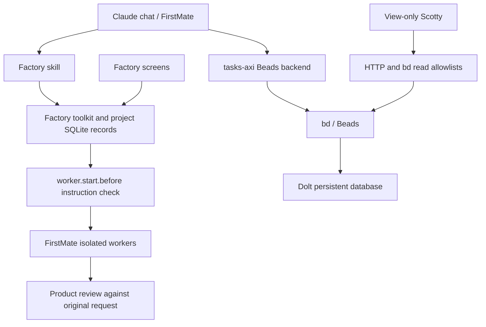

# Architecture

The cloned repository is both the distributable source tree and the FirstMate operational home.
Bundled components build in place; private installation records connect them using paths inside that same folder.

## Components and authority

| Component | Source | Responsibility |
| --- | --- | --- |
| FirstMate | Root `AGENTS.md`, `bin/`, `.agents/skills/` | Intake, registry, dispatch, isolated worktrees, supervision, delivery and approval |
| Factory | `factory/` | Request preservation, understanding/design/plan/detail, fidelity checks, project records and product review |
| Factory skill | `factory/skills/software-factory/` | Connect chat and return wakes to the toolkit and normal FirstMate flow |
| Start hook | `factory/scripts/worker-start-before.mjs` | Check the actual worker launch instructions through FirstMate's version 1 lifecycle-hook interface |
| tasks-axi | `tools/tasks-axi/` | Canonical execution-backlog operations, holds, dependencies and Beads transport |
| Beads | Official pinned bd release | Execution records in Dolt through a dedicated Unix socket |
| Dolt | Public image pinned by digest | Persistent Beads database with no published network port |
| Scotty | Public pinned source commit | Read-only task list and dependency graph behind HTTP and command allowlists |
| Factory screens | `factory/scripts/ui.mjs` | Product views and canonical mutations over the same toolkit records |
| Installation | `services/` | Public dependency pins, build, persistent dedicated services, guarded update and acceptance |

The factory does not replace the worker scheduler, add a second project registry or synchronize a parallel execution backlog.
Product project databases are SQLite; execution tasks are Beads in Dolt.
The hook registry points the start hook and screens at initialized project records.
Scotty's editing preference is not a write authority: both its exposed HTTP routes and its bd wrapper enforce read-only operations.
Docker publishes only loopback browser ports.
`factory/scripts/tailnet.mjs` optionally maps those ports through persistent Tailscale Serve HTTPS, preserving unrelated Serve configuration and refusing conflicting or Funnel-enabled ports.
The installation record owns the two exact tailnet origins; HTTP guards accept matching Host and Origin pairs and still reject cross-site requests.
Remote factory navigation uses the tailnet Scotty address; Scotty’s HTTP and command allowlists remain read-only.

## Startup and persistence

Claude loads the existing root `CLAUDE.md` pointer and SessionStart hooks.
Normal FirstMate startup reads the home's durable records; the factory skill is discoverable through the existing skill directory.
Docker owns the three always-on services with `unless-stopped` restart policies.
Dolt removes its stale Unix socket on restart; database files remain under the home.
The Docker daemon must start at boot independently of Claude.
Tailscaled owns background Serve configuration across reboots and must also start at boot when tailnet access is enabled.
See [FirstMate architecture](docs/architecture.md) for supported harness/runtime mechanisms and [lifecycle hooks](docs/lifecycle-hooks.md) for the extension contract.

## Setup, update and acceptance

`services/setup.mjs` installs into the current clean standalone clone and builds the bundled factory and tasks tool.
`services/dependencies.json` owns public source identities, checksums and image digests.
Setup never depends on an image or checkout assembled by another session.
Executable installation preserves running processes by atomically replacing changed binaries and retaining identical ones.
A completion record records source, binary and image identities only after service and real Claude checks succeed.
Re-running setup verifies the existing installation; a partial installation is retained for inspection.

`services/update.mjs` refuses dirty/diverged/wrong-branch source and unfinished workers before running the existing guarded FirstMate updater.
It rebuilds against the resulting source, preserves private configuration and service data, and finishes with acceptance.
Update acceptance uses FirstMate's existing `FM_STATE_OVERRIDE` to give its child session a private runtime-state directory under the same home, preserving the live caller's fleet lock.
The child still uses the actual installed source, local settings, hooks, executable, Beads backlog and screens.
Initial setup proves ordinary startup with the default state directory.
An update failure leaves durable evidence rather than resetting source or deleting data.

Acceptance exercises a real non-interactive Claude with normal startup and local settings, factory skill loading and backlog add/list/remove.
It also requires the factory screen, a probe and blocking dependency visible in Scotty, and refusal of Scotty create/edit/delete requests at both local and configured tailnet addresses.
Model prose is not the acceptance verdict: tool results, hook events, exact executable-path evidence and HTTP responses are checked.

## Data layout

| Path | Ownership and Git policy |
| --- | --- |
| `factory/`, `tools/tasks-axi/`, `services/`, root tooling | Tracked source and reproducible installation instructions |
| `data/` | Private project records, requests, plans, evidence, project registry and acceptance logs |
| `state/` | Private runtime, worker and session records |
| `config/` | Private hooks, agent profiles, settings, ports and installation record |
| `projects/` | Private registered project clones |
| `beads/` | Private bd executable, socket, workspace and persistent Dolt data |
| `.tools/` | Private executable shims, dependency downloads and build sources |
| `.claude/settings.local.json` | Private executable PATH and local agent settings |

A clone copies none of these private records.
Keep backups of the whole private home with services quiesced according to their own database backup procedures.
The [configuration reference](docs/configuration.md) owns FirstMate's operational-home schemas.

## Upstream maintenance

FirstMate history remains at the repository root; factory and tasks-axi history was imported under their directories.
For deliberate upstream maintenance, add `upstream` pointing at `https://github.com/kunchenguid/firstmate.git` and `tasks-upstream` at `https://github.com/kunchenguid/tasks-axi.git`.
Merge FirstMate upstream changes at the root and import tasks-axi updates with `git subtree pull --prefix=tools/tasks-axi tasks-upstream main` on a development branch, reviewing conflicts and rerunning acceptance.
Normal home updates follow this repository's origin and never merge those upstreams automatically.
